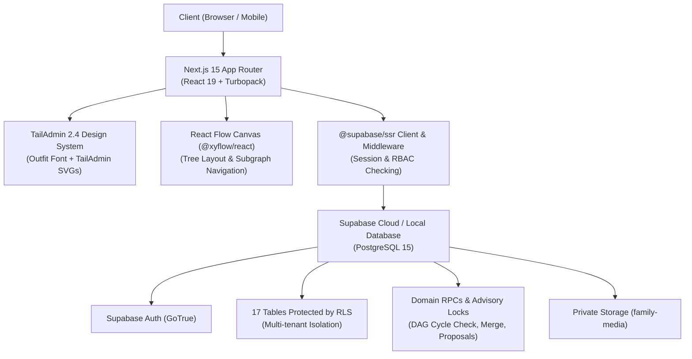

# 🌳 Pusaka Keluarga (Family Tree)

> **Platform Pencatatan & Penelusuran Silsilah Keluarga Besar Lintas Generasi Berbasis Bukti Otentik dan Graf Anti-Siklus.**

[](https://nextjs.org/)
[](https://react.dev/)
[](https://www.typescriptlang.org/)
[](https://tailwindcss.com/)
[](https://supabase.com/)
[](https://vitest.dev/)
[](https://tailadmin.com/)

---

## 📖 Tentang Aplikasi

**Pusaka Keluarga** adalah aplikasi web modern yang dirancang khusus untuk mendokumentasikan, memvisualisasikan, dan merawat silsilah keluarga besar (trah) di Indonesia secara kolaboratif, rapi, dan terpercaya.

Berbeda dari aplikasi pohon keluarga biasa, Pusaka Keluarga mengedepankan **metode genealogis berbasis bukti (*evidence-based genealogy*)**: setiap klaim hubungan keluarga, kelahiran, dan pernikahan harus dapat ditautkan ke sumber rujukan otentik (seperti Buku Silsilah Keraton/Trah, Akta Catatan Sipil Hindia Belanda/Burgerlijke Stand, Akta Kelahiran, Buku Nikah, atau arsip sejarah lisan).

---

## ✨ Fitur Utama

### 1. 🌿 Visualisasi Pohon Silsilah Interaktif (React Flow)
- Graf interaktif dengan `@xyflow/react` yang responsif di desktop maupun layar sentuh (mobile).
- Tiga mode tampilan silsilah:
  - **Mode Keturunan (*Descendants*)**: Menampilkan garis anak, cucu, cicit ke bawah.
  - **Mode Leluhur (*Ancestors*)**: Menampilkan garis orang tua, kakek-nenek, buyut ke atas.
  - **Mode Gabungan (*Hourglass*)**: Menampilkan kedua arah secara seimbang berpusat pada individu terpilih.
- Penanganan simpul serikat pernikahan (*Union Node*) yang mendukung monogami maupun poligini historis.
- Fitur *Zoom*, *Pan*, *MiniMap*, dan pemusatan kembali (*Re-center*).

### 2. 🛡️ Integritas Graf & Pencegahan Siklus (DAG)
- **Anti-Siklus Otomatis**: Dilengkapi algoritma deteksi siklus (DFS & PostgreSQL RPC) sehingga mustahil seseorang menjadi leluhur bagi dirinya sendiri.
- **Advisory Locks**: Mencegah kondisi balapan (*race condition*) saat relasi ditambahkan secara bersamaan oleh banyak kurator.

### 3. 📜 Genealogi Berbasis Bukti (*Evidence-Based Claims*)
- Pemisahan antara profil individu, pernyataan klaim fakta (*claims*), dan dokumen sumber (*sources*).
- Setiap peristiwa (tanggal lahir, tempat lahir, hubungan orang tua) memiliki tingkat keyakinan (*confidence level*).

### 4. 🔍 Deteksi Duplikat Cerdas (Ejaan Nusantara)
- Deteksi kemiripan nama dan ejaan lama Nusantara (ejaan Van Ophuijsen, Suwandi/Soewandi, hingga EYD modern, misalnya *Soedirjo* ↔ *Sudiryo*).
- Utilitas **Penggabungan Profil Duplikat (*Profile Merging*)** yang memigrasikan seluruh relasi, klaim, dan bukti secara transaksional tanpa kehilangan data.

### 5. 👥 Multi-Role & Keamanan Multi-Tenant (Supabase RLS)
- Keamanan berlapis berbasis **Row-Level Security (RLS)** dengan prinsip *deny-by-default*.
- 5 tingkat peran pengguna dalam Trah:
  1. **Owner**: Pemilik trah dengan hak penuh administrasi.
  2. **Family Admin**: Pengelola keanggotaan dan persetujuan usulan data.
  3. **Editor**: Kurator yang berhak mengedit data langsung.
  4. **Contributor**: Anggota keluarga yang dapat mengajukan usulan data (*change proposals*).
  5. **Reader**: Tamu/keluarga yang hanya memiliki izin baca data publik.

### 6. 🔄 Ekspor & Impor Standar Global
- **Cadangan JSON**: Cadangan komprehensif seluruh entitas trah untuk restorasi sistem.
- **Standar GEDCOM 5.5.1**: Format pertukaran silsilah internasional yang kompatibel dengan FamilySearch, Gramps, MyHeritage, dan RootsMagic.

### 7. 🎨 Desain Bersih & Elegan (TailAdmin 2.4.0)
- Tampilan antarmuka modern yang disesuaikan penuh dengan template resmi **TailAdmin 2.4.0**.
- Menggunakan tipografi resmi **Outfit** dari Google Fonts.
- Set ikon vektor SVG asli TailAdmin (`GridIcon`, `GroupIcon`, `BoxCubeIcon`, `DocsIcon`, `TaskIcon`, dll).
- Kartu metrik rounded halus (`rounded-2xl`), border abu-abu lembut (`#e4e7ec`), dan aksen biru royal TailAdmin (`#465fff`).

---

## 🏗️ Arsitektur Teknologi



---

## 🚀 Panduan Memulai Cepat (Local Development)

### Prasyarat
- **Node.js**: Versi `18.18+` atau `20+`
- **npm** atau **pnpm**
- **Docker Desktop** (jika menjalankan Supabase lokal)

### 1. Kloning Repositori
```bash
git clone https://github.com/username/Family-Tree.git
cd Family-Tree
```

### 2. Pasang Dependensi
```bash
npm install
```

### 3. Konfigurasi Environment Variables
Salin file `.env.local.example` menjadi `.env.local`:
```bash
cp .env.local.example .env.local
```

Isi variabel lingkungan sesuai proyek Supabase Anda:
```env
NEXT_PUBLIC_SUPABASE_URL=http://127.0.0.1:54321
NEXT_PUBLIC_SUPABASE_ANON_KEY=eyJhbGciOiJIUzI1NiIsInR5cCI6IkpXVCJ9...
SUPABASE_SERVICE_ROLE_KEY=eyJhbGciOiJIUzI1NiIsInR5cCI6IkpXVCJ9...
```

### 4. Jalankan Supabase Lokal & Migrasi (Opsional jika memakai Supabase lokal)
```bash
# Menjalankan kontainer Supabase lokal
npx supabase start

# Menjalankan migrasi skema database
npx supabase migration up

# Menjalankan data benih (seed synthetic)
npx supabase db reset
```

### 5. Jalankan Server Pengembangan (Dev Server)
Aplikasi ini dioptimalkan menggunakan **Turbopack**:
```bash
npm run dev
```

Buka peramban Anda di: **`http://localhost:3000`**

---

## 🔑 Akun Uji Coba Bawaan (Synthetic Seed Data)

Untuk mempermudah eksplorasi lokal, database benih telah dilengkapi akun sintetis dengan data contoh keluarga besar **Bani Kartowidjojo**:

| Peran (Role) | Email | Kata Sandi | Wewenang |
| :--- | :--- | :--- | :--- |
| **Owner / Superadmin** | `admin@pusakakeluarga.id` | `Rahasia123!` | Akses penuh seluruh modul & pengaturan |
| **Editor** | `siti.editor@pusakakeluarga.id` | `Rahasia123!` | Kurasi silsilah & persetujuan data |
| **Contributor** | `bambang.contrib@pusakakeluarga.id` | `Rahasia123!` | Pengusul perubahan data keluarga |

---

## 🧪 Pengujian (Testing)

Proyek ini dilengkapi rangkaian pengujian unit, integrasi aturan domain, dan simulasi RLS:

```bash
# Menjalankan seluruh unit test (54 tests)
npm run test

# Menjalankan test dalam mode pantau (watch mode)
npm run test:watch

# Menjalankan verifikasi kompilasi produksi
npm run build
```

### Cakupan Pengujian:
- ✅ **Deteksi Siklus Graf**: Pencegahan relasi leluhur sirkuler (*cycle detection*).
- ✅ **Simulasi RLS & RBAC**: Otorisasi multi-tenant dan pengujian 5 peran keluarga.
- ✅ **Deteksi Duplikat**: Pencocokan fonetik dan normalisasi ejaan kuno (*Suwandi/EYD*).
- ✅ **Transfer Data**: Ekspor & impor berkas JSON dan parser GEDCOM 5.5.1.
- ✅ **Alur Usulan**: Validasi pengajuan dan persetujuan usulan perubahan data.

---

## 📁 Struktur Direktori Proyek

```plaintext
Family-Tree/
├── docs/                     # Dokumentasi arsitektur, ERD, keamanan, & acceptance criteria
├── src/
│   ├── app/                  # Next.js App Router
│   │   ├── (auth)/           # Rute otentikasi (login, register, forgot-password)
│   │   ├── (dashboard)/      # Rute dashboard terproteksi (dashboard, pohon, direktori, dll)
│   │   ├── globals.css       # Tailwind & CSS variables TailAdmin 2.4
│   │   └── layout.tsx        # Root layout dengan Google Font Outfit
│   ├── components/
│   │   ├── icons/            # tailadmin-icons.tsx (Vektor SVG resmi TailAdmin)
│   │   └── navigation/       # Sidebar, Header, dan Backdrop TailAdmin
│   ├── context/
│   │   └── SidebarContext.tsx # Manajemen state drawer & collapse sidebar
│   ├── features/
│   │   ├── claims-sources/   # Modul bukti otentik & kutipan dokumen
│   │   ├── data-transfer/    # Layanan ekspor & impor JSON / GEDCOM
│   │   ├── genealogy-tree/   # Komponen React Flow & algoritma layouting pohon
│   │   ├── persons/          # Logika profil & deteksi duplikat individu
│   │   └── reviews/          # Logika kurasi usulan perubahan data
│   ├── lib/
│   │   ├── permissions/      # Simulasi & pembantu hak akses RBAC
│   │   ├── supabase/         # Client, Server, & Middleware Supabase (@supabase/ssr)
│   │   └── validators/       # Skema validasi Zod
│   └── types/                # Definisi tipe TypeScript & skema database
├── supabase/
│   ├── migrations/           # Skrip migrasi PostgreSQL (17 tabel, RLS, functions)
│   └── seed.sql              # Data benih sintetis Trah Kartowidjojo
├── tailwind.config.ts        # Konfigurasi token warna, font, dan bayangan TailAdmin
├── tsconfig.json             # Konfigurasi TypeScript strict mode
└── package.json              # Dependensi pustaka dan skrip proyek
```

---

## 📄 Lisensi

Hak Cipta © 2026 **Pusaka Keluarga Team**. Proyek ini dikembangkan untuk pelestarian sejarah silsilah keluarga besar nusantara.

