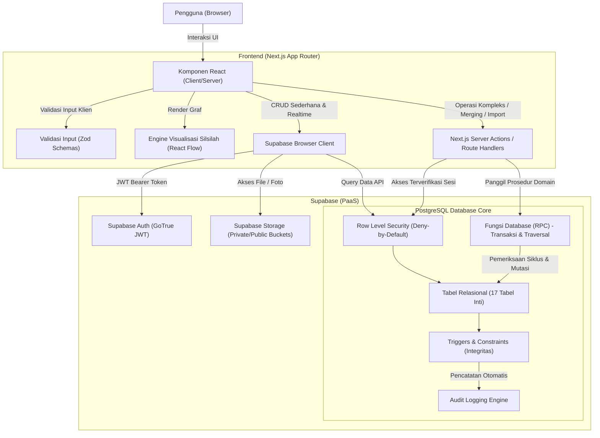

# Arsitektur Sistem — Pusaka Keluarga

Dokumen ini mendefinisikan arsitektur sistem, keputusan teknologi, struktur direktori, dan batas tanggung jawab komponen aplikasi **Pusaka Keluarga**.

---

## 1. Ringkasan Eksekutif

**Pusaka Keluarga** adalah platform silsilah keluarga kolaboratif berbasis web yang dirancang untuk mendokumentasikan, memverifikasi, dan menelusuri hubungan kekeluargaan lintas generasi secara akurat. Sistem ini mengutamakan integritas data genealogis, penelusuran klaim berbasis bukti sumber, pencegahan anomali relasi (seperti siklus leluhur), dan keamanan data bertingkat melalui Row Level Security (RLS).

---

## 2. Stack Teknologi & Rasional

| Lapisan | Teknologi | Rasional Pemilihan |
| :--- | :--- | :--- |
| **Frontend Framework** | Next.js 15+ (App Router) & React 19 | Server-Side Rendering (SSR), Server Components (RSC) untuk keamanan data, Server Actions/Route Handlers untuk mutasi terproteksi, optimasi performa tinggi. |
| **Bahasa Pemrograman** | TypeScript (Strict Mode) | Menjamin *type-safety* *end-to-end* dari skema database Supabase hingga komponen UI. |
| **Penyedia Backend & DB**| Supabase (PostgreSQL 15+) | Database relasional berfitur lengkap (ACID, Recursive CTEs, Constraints, Triggers, RPC, RLS) terintegrasi dengan Auth dan S3-compatible Storage. |
| **Autentikasi** | Supabase Auth (GoTrue) | Pengelolaan sesi berbasis JWT yang aman, sinkronisasi otomatis ke tabel profil publik/privat. |
| **Otorisasi Data** | PostgreSQL Row Level Security (RLS) | Prinsip *deny-by-default* diterapkan di tingkat database terdalam. Menghindari kebocoran data terlepas dari layer aplikasi. |
| **Visualisasi Silsilah** | React Flow (`@xyflow/react`) | Diagram alir nodus interaktif performa tinggi untuk pohon leluhur dan keturunan dengan kontrol subgraph dinamis. |
| **Validasi Skema** | Zod | Validasi deklaratif untuk masukan formulir UI dan payload API/Route Handlers. |
| **Styling & UI** | Tailwind CSS + Lucide React | Tampilan modern, responsif untuk perangkat mobile dan desktop, dalam Bahasa Indonesia. |
| **Testing** | Vitest, pgTAP / Supabase db test, Playwright | Pengujian unit fungsi domain, pengujian kebijakan RLS multi-peran, dan pengujian end-to-end alur kritis pengguna. |
| **Deployment** | Vercel (Frontend) + Supabase Cloud (DB) | Integrasi CI/CD otomatis, edge network, dan skalabilitas global. |

---

## 3. Struktur Repository & Organisasi Modul

```
Family-Tree/
├── .github/                  # CI/CD workflows (GitHub Actions)
├── docs/                     # Dokumentasi teknis & arsitektur
│   ├── arsitektur.md         # Arsitektur sistem & komponen
│   ├── erd.md                # Entity-Relationship Diagram & detail skema
│   ├── aturan-domain.md      # Aturan bisnis silsilah, siklus & klaim
│   ├── keamanan.md           # Model hak akses, RBAC, RLS & audit
│   └── acceptance-criteria.md# Kriteria keberterimaan tiap fase
├── public/                   # Aset publik statis (logo, favicon, ikon)
├── src/
│   ├── app/                  # Next.js App Router (Pages, Layouts, Route Handlers)
│   │   ├── (auth)/           # Route group autentikasi (login, register, forgot-password)
│   │   ├── (dashboard)/      # Route group area terotentikasi (dashboard, tree, persons, etc.)
│   │   │   ├── dashboard/
│   │   │   ├── pohon/        # Visualisasi pohon silsilah interaktif
│   │   │   ├── direktori/    # Direktori & pencarian individu
│   │   │   ├── individu/     # Detail profil, riwayat hidup, relasi individu
│   │   │   ├── kontribusi/   # Usulan perubahan & persetujuan kurator
│   │   │   ├── sumber/       # Pengelolaan repositori sumber & arsip
│   │   │   ├── anggota/      # Manajemen anggota keluarga & peran
│   │   │   └── pengaturan/   # Konfigurasi keluarga & preferensi
│   │   ├── api/              # Route Handlers internal (ekspor, impor, webhook, rpc proxy)
│   │   ├── layout.tsx
│   │   └── page.tsx
│   ├── components/           # Komponen UI global (Button, Modal, Input, Layouts, Nav)
│   │   ├── ui/               # Primitif UI (Tailwind)
│   │   ├── feedback/         # Toast, alert, loading spinner
│   │   └── navigation/       # Navbar, sidebar, breadcrumb
│   ├── features/             # Modul domain terisolasi
│   │   ├── genealogy-tree/   # Logika nodus pohon React Flow, traversal subgraph
│   │   ├── persons/          # Profil individu, form biodata, nama alternatif
│   │   ├── relationships/    # Manajemen relasi orang tua-anak, pasangan/unions
│   │   ├── claims-sources/   # Pencatatan klaim, peninjauan fakta, upload bukti sumber
│   │   ├── reviews/          # Review usulan perubahan (change proposals)
│   │   └── family-admin/     # Kelola peran anggota, perizinan, pengaturan pohon
│   ├── lib/                  # Utilitas & pustaka bersama
│   │   ├── supabase/         # Client Supabase (browser client, server client, middleware)
│   │   ├── permissions/      # Helper pengecekan otorisasi di layer TypeScript
│   │   ├── validators/       # Skema Zod untuk validasi form & request
│   │   ├── date-utils/       # Representasi tanggal perkiraan/historis
│   │   └── utils.ts          # Utilitas umum (formatting, string manipulation)
│   └── types/                # Definisi tipe TypeScript global & hasil generate Supabase
│       ├── database.types.ts # Tipe otomatis dari skema Supabase
│       ├── genealogy.ts      # Tipe domain pohon silsilah
│       └── auth.ts           # Tipe sesi & keanggotaan
├── supabase/
│   ├── migrations/           # Skrip migrasi SQL versi terurut
│   ├── tests/                # Skrip pengujian SQL (pgTAP & skenario RLS)
│   ├── seed.sql              # Data sintetis untuk pengujian lokal
│   └── config.toml           # Konfigurasi Supabase CLI
├── vitest.config.ts          # Konfigurasi Vitest
├── playwright.config.ts      # Konfigurasi Playwright E2E
├── tailwind.config.ts        # Konfigurasi Tailwind CSS
├── tsconfig.json             # Konfigurasi TypeScript (strict mode)
└── package.json
```

---

## 4. Pola Aliran Data & Tanggung Jawab Lapisan



### Prinsip Aliran Operasi:
1. **CRUD Sederhana**: Komponen klien berinteraksi langsung via Supabase Data API menggunakan JWT pengguna. Otorisasi disaring 100% oleh RLS di level PostgreSQL.
2. **Operasi Domain Kompleks**: Dijalankan via PostgreSQL Stored Procedures (RPC) atau Server Actions/Route Handlers. Contoh:
   - Menambahkan relasi anak-orangtua dengan validasi anti-siklus (*cycle detection*).
   - Penggabungan dua profil individu (*profile merging*) dengan migrasi relasi dan klaim.
   - Penyetujuan usulan perubahan (*change proposal review*) secara transaksional.
   - Penelusuran subgraph leluhur/keturunan hingga kedalaman $N$ (maksimum parameter depth).

---

## 5. Strategi Tanggal Historis & Fleksibilitas Data

Silsilah keluarga sering kali memiliki data tanggal lahir/wafat yang tidak pasti (contoh: "sekitar tahun 1895", "sebelum 1920", "antara Mei 1910 dan Juni 1912").
Sistem **Pusaka Keluarga** tidak memaksa tanggal pasti jika sumber tidak menyediakannya.

Setiap entitas dengan komponen tanggal (kelahiran, kematian, pernikahan) menggunakan model gabungan:
- `date_exact`: `DATE` (nullable) — Digunakan jika tanggal pasti diketahui.
- `date_year`: `SMALLINT` (nullable) — Digunakan untuk kalkulasi kasar/rentang usia.
- `date_type`: `ENUM ('EXACT', 'APPROXIMATE', 'BEFORE', 'AFTER', 'BETWEEN', 'UNKNOWN')`.
- `date_text`: `VARCHAR(100)` — Catatan tekstual asli dari sumber (misal: "Kira-kira awal zaman pendudukan Jepang").

---

## 6. Strategi Subgraph Traversal (React Flow)

Pohon keluarga besar dapat memiliki ribuan entitas. Memuat seluruh pohon sekaligus ke memori peramban menyebabkan penurunan performa kritis.
Sistem menerapkan **Subgraph Traversal Dinamis**:
1. Pengguna menentukan *Focus Individual* (Individu Utama).
2. Sistem memanggil RPC `get_family_subgraph(p_person_id UUID, p_ancestor_depth INT, p_descendant_depth INT)`.
3. Default kedalaman dibatasi: Leluhur $\le 4$ generasi, Keturunan $\le 2$ generasi.
4. Nodus di peramban memiliki tombol expand (+) yang secara asinkron mengambil cabang berikutnya tanpa memuat ulang graf.

