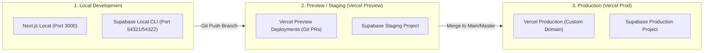

# Panduan Deployment & Operasional Produksi — Pusaka Keluarga
## Next.js (Vercel) + Supabase Cloud (PostgreSQL, Auth, Storage)

Dokumen ini memuat panduan lengkap penerapan aplikasi **Pusaka Keluarga** ke lingkungan produksi, pemisahan lingkungan (*development*, *preview*, *production*), pengelolaan *secrets*, serta prosedur pencadangan dan pemulihan bencana (*disaster recovery*).

---

## 1. Arsitektur Lingkungan & Pemisahan



| Lingkungan | Frontend Hosting | Database & Auth | Keterangan Data |
| :--- | :--- | :--- | :--- |
| **Development** | `http://localhost:3000` | Supabase Local / Dev Project | Data sintetis fiktif (`supabase/seed.sql`). |
| **Preview / Staging** | `https://*-pusaka-keluarga.vercel.app` | Supabase Staging Project | Data pengujian otomatis & QA. |
| **Production** | Domain Kustom Vercel | Supabase Production Project | Data keluarga riil terenkripsi penuh. |

---

## 2. Persiapan Proyek Supabase Cloud

### 2.1. Membuat Proyek Baru
1. Buka [Supabase Dashboard](https://supabase.com/dashboard) dan buat organisasi baru jika belum ada.
2. Klik **New project**:
   - **Name**: `pusaka-keluarga-prod`
   - **Database Password**: Buat kata sandi kuat (minimal 16 karakter, simpan di password manager aman).
   - **Region**: Pilih region terdekat dengan pengguna (misalnya: `Singapore (ap-southeast-1)` untuk latensi terendah dari Indonesia).
   - **Pricing Plan**: Pro tier (direkomendasikan untuk backup harian otomatis dan kapasitas penyimpanan dokumen keluarga).

### 2.2. Mengambil Kredensial API
Pada menu **Project Settings** $\rightarrow$ **API**:
- **Project URL**: `https://<project-ref>.supabase.co` $\rightarrow$ Simpan sebagai `NEXT_PUBLIC_SUPABASE_URL`
- **anon / public key**: `eyJhbGciOi...` $\rightarrow$ Simpan sebagai `NEXT_PUBLIC_SUPABASE_ANON_KEY`
- **service_role key**: `eyJhbGciOi...` $\rightarrow$ Simpan sebagai `SUPABASE_SERVICE_ROLE_KEY` *(HANYA di backend/server, JANGAN PERNAH diekspos ke klien!)*

---

## 3. Penerapan Migrasi Skema ke Supabase Cloud

Semua perubahan database harus diterapkan secara terurut menggunakan Supabase CLI:

### 3.1. Hubungkan CLI ke Proyek Cloud
```bash
# Login ke akun Supabase via CLI
npx supabase login

# Tautkan direktori lokal ke project ref cloud
npx supabase link --project-ref <your-supabase-project-ref>
```

### 3.2. Terapkan Seluruh File Migrasi
Periksa bahwa ke-4 file migrasi diterapkan berurutan:
1. `20250101000000_initial_schema.sql` (17 Tabel inti, ENUM, indeks GIN/Btree)
2. `20250102000000_domain_functions.sql` (Anti-siklus DAG, Traversal leluhur/keturunan, Merger profil)
3. `20250103000000_auth_and_rls.sql` (Trigger profil, helper SECURITY DEFINER, Kebijakan RLS 17 tabel)
4. `20250104000000_proposals_and_media.sql` (Bucket storage `family-media`, RPC approve/reject usulan)

Jalankan perintah push migrasi:
```bash
npx supabase db push
```

> [!IMPORTANT]
> Jangan menjalankan `supabase db reset` pada lingkungan produksi karena perintah tersebut akan menghapus seluruh data yang ada. Gunakan selalu `supabase db push`.

---

## 4. Konfigurasi Autentikasi & Storage di Supabase Cloud

### 4.1. Redirect URLs (Supabase Auth)
Buka menu **Authentication** $\rightarrow$ **URL Configuration**:
- **Site URL**: `https://pusakakeluarga.id` (atau domain produksi Anda)
- **Redirect URLs**:
  - `https://pusakakeluarga.id/**`
  - `https://pusakakeluarga.id/auth/callback`
  - `https://*-your-team.vercel.app/**` (Untuk pratinjau Vercel branch)
  - `http://localhost:3000/**` (Hanya untuk project development)

### 4.2. Pengaturan Email Provider
Pada menu **Authentication** $\rightarrow$ **Email Templates**:
- Sesuaikan template email konfirmasi pendaftaran dan reset kata sandi ke dalam Bahasa Indonesia dengan identitas Pusaka Keluarga.
- Aktifkan Custom SMTP (misal via Resend / AWS SES) agar email tidak masuk ke folder spam.

### 4.3. Verifikasi Storage Bucket
Buka menu **Storage**:
- Pastikan bucket `family-media` terdaftar.
- Pastikan opsi **Public bucket** bernilai `OFF` (Privat).
- Kebijakan RLS storage telah otomatis terpasang melalui migrasi `20250104000000_proposals_and_media.sql`.

---

## 5. Deployment ke Vercel

### 5.1. Import Repository ke Vercel
1. Buka [Vercel Dashboard](https://vercel.com) dan klik **Add New** $\rightarrow$ **Project**.
2. Pilih repository Git `Family-Tree`.
3. Framework Preset: **Next.js** (terdeteksi otomatis).
4. Root Directory: `./`.

### 5.2. Konfigurasi Environment Variables di Vercel
Tambahkan variabel berikut pada tab **Environment Variables**:

| Nama Variabel | Lingkungan | Nilai Contoh |
| :--- | :--- | :--- |
| `NEXT_PUBLIC_SUPABASE_URL` | Production, Preview, Dev | `https://xxxx.supabase.co` |
| `NEXT_PUBLIC_SUPABASE_ANON_KEY` | Production, Preview, Dev | `eyJhbGciOi...` |
| `SUPABASE_SERVICE_ROLE_KEY` | Production, Preview, Dev | `eyJhbGciOi...` (Secret) |
| `NEXT_PUBLIC_SITE_URL` | Production | `https://pusakakeluarga.id` |
| `NEXT_PUBLIC_SITE_URL` | Preview | `https://$VERCEL_URL` |

### 5.3. Deploy
Klik tombol **Deploy**. Vercel akan menjalankan:
- `npm run build`
- Type checking TypeScript strict mode
- Static page generation
- Edge Middleware deployment

---

## 6. Prosedur Pencadangan & Pemulihan Bencana (Disaster Recovery)

### 6.1. Pencadangan Otomatis Supabase
- Supabase Pro project menyediakan *Daily Automated Backups* dengan retensi hingga 30 hari.
- Aktifkan *Point-in-Time Recovery (PITR)* pada Supabase untuk pemulihan hingga detik tertentu jika terjadi kesalahan operasional manusia.

### 6.2. Pencadangan Manual via CLI
Lakukan dump database berkala sebelum perubahan besar:
```bash
# Dump skema dan data
npx supabase db dump --project-ref <your-ref> -f backup_$(date +%Y%m%d).sql
```

### 6.3. Cadangan Tingkat Aplikasi
- Pengguna (Owner/Admin) dapat memanfaatkan fitur bawaan aplikasi pada menu **Pengaturan** $\rightarrow$ **Ekspor Backup JSON** dan **Ekspor GEDCOM 5.5.1**.
- Berkas JSON cadangan memuat seluruh entitas relasional keluarga beserta riwayat klaim yang dapat dipulihkan kapan saja melalui fitur **Impor & Pemulihan**.

---

## 7. Checklist Verifikasi Go-Live

- [x] RLS aktif dan diuji deny-by-default pada 17 tabel inti.
- [x] Tidak ada service-role key yang diekspos di kode sisi klien / browser.
- [x] File `.env` dan `.env.local` tidak di-*commit* ke Git (`.gitignore` aktif).
- [x] Bucket `family-media` berstatus privat dan hanya dapat diakses melalui URL bertanda tangan.
- [x] Redirect URL Supabase Auth telah mendaftarkan domain produksi.
- [x] Pemeriksaan siklus leluhur (*cycle detection*) aktif di database RPC.
- [x] Data sintetis tidak tercampur dengan data keluarga nyata di produksi.

