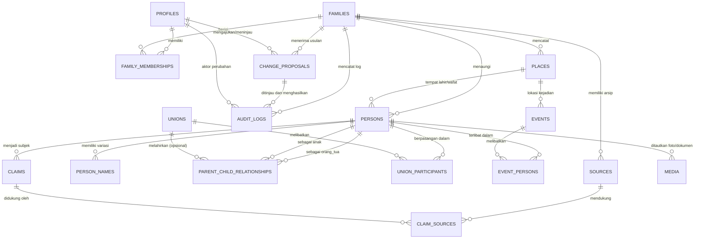

# Entity-Relationship Diagram (ERD) & Skema Database — Pusaka Keluarga

Dokumen ini memuat arsitektur database relasional PostgreSQL untuk **Pusaka Keluarga**, mencakup 17 entitas inti, relasi antar tabel, tipe data, *primary key* (UUID v4), *foreign keys*, indeks, dan aturan *cascade*.

---

## 1. Diagram Konseptual (Mermaid)

---

## 2. Spesifikasi Skema 17 Tabel Inti

### 2.1. Tabel Autentikasi & Keanggotaan

#### `profiles`
Menyimpan data profil pengguna aplikasi yang terhubung ke identitas `auth.users` Supabase.
- `id`: `UUID PRIMARY KEY REFERENCES auth.users(id) ON DELETE CASCADE`
- `full_name`: `TEXT NOT NULL`
- `avatar_url`: `TEXT`
- `phone`: `TEXT`
- `is_superadmin`: `BOOLEAN NOT NULL DEFAULT FALSE`
- `created_at`: `TIMESTAMPTZ NOT NULL DEFAULT now()`
- `updated_at`: `TIMESTAMPTZ NOT NULL DEFAULT now()`

#### `families`
Mewakili satu ruang lingkup pohon silsilah keluarga besar (multi-tenant/keluarga terisolasi).
- `id`: `UUID PRIMARY KEY DEFAULT gen_random_uuid()`
- `name`: `VARCHAR(150) NOT NULL`
- `description`: `TEXT`
- `cover_image_url`: `TEXT`
- `root_person_id`: `UUID` *(Forward reference, di-update setelah persons ada)*
- `is_private`: `BOOLEAN NOT NULL DEFAULT TRUE`
- `created_by`: `UUID NOT NULL REFERENCES profiles(id)`
- `created_at`: `TIMESTAMPTZ NOT NULL DEFAULT now()`
- `updated_at`: `TIMESTAMPTZ NOT NULL DEFAULT now()`

#### `family_memberships`
Menghubungkan akun pengguna dengan keluarga beserta hak perannya.
- `id`: `UUID PRIMARY KEY DEFAULT gen_random_uuid()`
- `family_id`: `UUID NOT NULL REFERENCES families(id) ON DELETE CASCADE`
- `profile_id`: `UUID NOT NULL REFERENCES profiles(id) ON DELETE CASCADE`
- `role`: `VARCHAR(30) NOT NULL CHECK (role IN ('owner', 'family_admin', 'editor', 'contributor', 'reader'))`
- `status`: `VARCHAR(20) NOT NULL DEFAULT 'active' CHECK (status IN ('invited', 'active', 'suspended'))`
- `invited_by`: `UUID REFERENCES profiles(id)`
- `created_at`: `TIMESTAMPTZ NOT NULL DEFAULT now()`
- `updated_at`: `TIMESTAMPTZ NOT NULL DEFAULT now()`
- **Constraint Unique**: `UNIQUE(family_id, profile_id)`

---

### 2.2. Entitas Inti Genealogi & Relasi

#### `places`
Master lokasi terstruktur untuk tempat lahir, wafat, pemakaman, pernikahan, dll.
- `id`: `UUID PRIMARY KEY DEFAULT gen_random_uuid()`
- `family_id`: `UUID NOT NULL REFERENCES families(id) ON DELETE CASCADE`
- `name`: `VARCHAR(200) NOT NULL` *(Contoh: "Kecamatan Singosari, Malang, Jawa Timur")*
- `latitude`: `NUMERIC(10, 7)`
- `longitude`: `NUMERIC(10, 7)`
- `created_at`: `TIMESTAMPTZ NOT NULL DEFAULT now()`

#### `persons`
Individu dalam pohon silsilah keluarga (identitas stabil, unik).
- `id`: `UUID PRIMARY KEY DEFAULT gen_random_uuid()`
- `family_id`: `UUID NOT NULL REFERENCES families(id) ON DELETE CASCADE`
- `primary_name`: `VARCHAR(200) NOT NULL`
- `nickname`: `VARCHAR(100)`
- `gender`: `VARCHAR(20) NOT NULL CHECK (gender IN ('male', 'female', 'unknown', 'other'))`
- `is_living`: `BOOLEAN NOT NULL DEFAULT TRUE`
- `birth_date_exact`: `DATE`
- `birth_date_year`: `SMALLINT`
- `birth_date_type`: `VARCHAR(20) NOT NULL DEFAULT 'UNKNOWN' CHECK (birth_date_type IN ('EXACT', 'APPROXIMATE', 'BEFORE', 'AFTER', 'BETWEEN', 'UNKNOWN'))`
- `birth_date_text`: `VARCHAR(100)`
- `birth_place_id`: `UUID REFERENCES places(id) ON DELETE SET NULL`
- `death_date_exact`: `DATE`
- `death_date_year`: `SMALLINT`
- `death_date_type`: `VARCHAR(20) NOT NULL DEFAULT 'UNKNOWN' CHECK (death_date_type IN ('EXACT', 'APPROXIMATE', 'BEFORE', 'AFTER', 'BETWEEN', 'UNKNOWN'))`
- `death_date_text`: `VARCHAR(100)`
- `death_place_id`: `UUID REFERENCES places(id) ON DELETE SET NULL`
- `burial_place_id`: `UUID REFERENCES places(id) ON DELETE SET NULL`
- `bio`: `TEXT`
- `avatar_media_id`: `UUID` *(Tautan ke foto utama)*
- `is_private`: `BOOLEAN NOT NULL DEFAULT FALSE`
- `created_by`: `UUID REFERENCES profiles(id) ON DELETE SET NULL`
- `created_at`: `TIMESTAMPTZ NOT NULL DEFAULT now()`
- `updated_at`: `TIMESTAMPTZ NOT NULL DEFAULT now()`

#### `person_names`
Nama alternatif, nama alias, nama gelar/kebangsawanan, nama gadis (maiden name).
- `id`: `UUID PRIMARY KEY DEFAULT gen_random_uuid()`
- `person_id`: `UUID NOT NULL REFERENCES persons(id) ON DELETE CASCADE`
- `name`: `VARCHAR(200) NOT NULL`
- `type`: `VARCHAR(30) NOT NULL CHECK (type IN ('alias', 'birth_name', 'married_name', 'title', 'religious_name', 'posthumous_name'))`
- `notes`: `TEXT`
- `created_at`: `TIMESTAMPTZ NOT NULL DEFAULT now()`

#### `unions`
Pernikahan atau ikatan hubungan antar pasangan.
- `id`: `UUID PRIMARY KEY DEFAULT gen_random_uuid()`
- `family_id`: `UUID NOT NULL REFERENCES families(id) ON DELETE CASCADE`
- `type`: `VARCHAR(30) NOT NULL DEFAULT 'marriage' CHECK (type IN ('marriage', 'civil_union', 'religious', 'customary', 'unmarried', 'unknown'))`
- `status`: `VARCHAR(20) NOT NULL DEFAULT 'active' CHECK (status IN ('active', 'divorced', 'annulled', 'widowed', 'separated', 'unknown'))`
- `start_date_exact`: `DATE`
- `start_date_year`: `SMALLINT`
- `start_date_type`: `VARCHAR(20) DEFAULT 'UNKNOWN'`
- `start_date_text`: `VARCHAR(100)`
- `end_date_exact`: `DATE`
- `end_date_year`: `SMALLINT`
- `end_date_type`: `VARCHAR(20) DEFAULT 'UNKNOWN'`
- `end_date_text`: `VARCHAR(100)`
- `place_id`: `UUID REFERENCES places(id) ON DELETE SET NULL`
- `notes`: `TEXT`
- `created_at`: `TIMESTAMPTZ NOT NULL DEFAULT now()`
- `updated_at`: `TIMESTAMPTZ NOT NULL DEFAULT now()`

#### `union_participants`
Menghubungkan orang ke dalam satu relasi pasangan (mendukung hubungan multi-orang/poligami historis bila ada bukti).
- `id`: `UUID PRIMARY KEY DEFAULT gen_random_uuid()`
- `union_id`: `UUID NOT NULL REFERENCES unions(id) ON DELETE CASCADE`
- `person_id`: `UUID NOT NULL REFERENCES persons(id) ON DELETE CASCADE`
- `role`: `VARCHAR(30) NOT NULL DEFAULT 'partner' CHECK (role IN ('husband', 'wife', 'partner'))`
- `order_index`: `SMALLINT DEFAULT 1`
- `created_at`: `TIMESTAMPTZ NOT NULL DEFAULT now()`
- **Constraint Unique**: `UNIQUE(union_id, person_id)`

#### `parent_child_relationships`
Menghubungkan orang tua dengan anak secara granular.
- `id`: `UUID PRIMARY KEY DEFAULT gen_random_uuid()`
- `family_id`: `UUID NOT NULL REFERENCES families(id) ON DELETE CASCADE`
- `parent_id`: `UUID NOT NULL REFERENCES persons(id) ON DELETE CASCADE`
- `child_id`: `UUID NOT NULL REFERENCES persons(id) ON DELETE CASCADE`
- `union_id`: `UUID REFERENCES unions(id) ON DELETE SET NULL` *(Opsional: menghubungkan ke serikat pernikahan orang tua yang mana)*
- `relationship_type`: `VARCHAR(30) NOT NULL DEFAULT 'biological' CHECK (relationship_type IN ('biological', 'adopted', 'step', 'foster', 'guardian', 'unknown'))`
- `confidence`: `VARCHAR(20) NOT NULL DEFAULT 'verified' CHECK (confidence IN ('verified', 'probable', 'uncertain', 'disputed'))`
- `notes`: `TEXT`
- `created_at`: `TIMESTAMPTZ NOT NULL DEFAULT now()`
- **Constraint Check**: `CHECK (parent_id <> child_id)`
- **Constraint Unique**: `UNIQUE(parent_id, child_id)`

---

### 2.3. Rekaman Bukti: Sumber, Klaim, dan Media

#### `sources`
Sumber informasi rujukan (dokumen, akta lahir, buku silsilah, wawancara, foto nisan).
- `id`: `UUID PRIMARY KEY DEFAULT gen_random_uuid()`
- `family_id`: `UUID NOT NULL REFERENCES families(id) ON DELETE CASCADE`
- `title`: `VARCHAR(250) NOT NULL`
- `author`: `VARCHAR(200)`
- `publication_date`: `VARCHAR(100)`
- `repository`: `TEXT` *(Lokasi fisik/arsip asli disimpan)*
- `source_type`: `VARCHAR(30) NOT NULL CHECK (source_type IN ('birth_certificate', 'death_certificate', 'marriage_certificate', 'family_book', 'oral_history', 'grave_stone', 'census', 'photograph', 'other'))`
- `citation_text`: `TEXT`
- `url`: `TEXT`
- `created_by`: `UUID REFERENCES profiles(id) ON DELETE SET NULL`
- `created_at`: `TIMESTAMPTZ NOT NULL DEFAULT now()`
- `updated_at`: `TIMESTAMPTZ NOT NULL DEFAULT now()`

#### `claims`
Pernyataan fakta genealogis yang dapat diverifikasi secara mandiri.
- `id`: `UUID PRIMARY KEY DEFAULT gen_random_uuid()`
- `family_id`: `UUID NOT NULL REFERENCES families(id) ON DELETE CASCADE`
- `subject_person_id`: `UUID REFERENCES persons(id) ON DELETE CASCADE`
- `claim_type`: `VARCHAR(50) NOT NULL` *(Contoh: 'birth_date', 'parentage', 'death_place', 'historical_event')*
- `predicate`: `TEXT NOT NULL` *(Pernyataan ringkas)*
- `raw_data`: `JSONB NOT NULL DEFAULT '{}'` *(Nilai data yang diklaim)*
- `status`: `VARCHAR(30) NOT NULL DEFAULT 'belum_ditinjau' CHECK (status IN ('belum_ditinjau', 'sedang_ditinjau', 'diterima', 'diperdebatkan', 'ditolak'))`
- `notes`: `TEXT`
- `created_by`: `UUID REFERENCES profiles(id) ON DELETE SET NULL`
- `created_at`: `TIMESTAMPTZ NOT NULL DEFAULT now()`
- `updated_at`: `TIMESTAMPTZ NOT NULL DEFAULT now()`

#### `claim_sources`
Menghubungkan klaim dengan satu atau banyak sumber bukti pendukung.
- `id`: `UUID PRIMARY KEY DEFAULT gen_random_uuid()`
- `claim_id`: `UUID NOT NULL REFERENCES claims(id) ON DELETE CASCADE`
- `source_id`: `UUID NOT NULL REFERENCES sources(id) ON DELETE CASCADE`
- `page_or_reference`: `VARCHAR(100)` *(Halaman / nomor kutipan spesifik)*
- `evidence_quality`: `VARCHAR(20) NOT NULL DEFAULT 'direct' CHECK (evidence_quality IN ('direct', 'indirect', 'hearsay', 'questionable'))`
- `created_at`: `TIMESTAMPTZ NOT NULL DEFAULT now()`
- **Constraint Unique**: `UNIQUE(claim_id, source_id)`

#### `media`
Penyimpanan metadata berkas dan dokumen privat yang diunggah ke Supabase Storage.
- `id`: `UUID PRIMARY KEY DEFAULT gen_random_uuid()`
- `family_id`: `UUID NOT NULL REFERENCES families(id) ON DELETE CASCADE`
- `person_id`: `UUID REFERENCES persons(id) ON DELETE SET NULL`
- `source_id`: `UUID REFERENCES sources(id) ON DELETE SET NULL`
- `storage_path`: `TEXT NOT NULL` *(Path di dalam Supabase Storage Bucket `family-media`)*
- `file_name`: `VARCHAR(255) NOT NULL`
- `file_type`: `VARCHAR(50) NOT NULL`
- `file_size_bytes`: `BIGINT NOT NULL`
- `caption`: `TEXT`
- `is_private`: `BOOLEAN NOT NULL DEFAULT TRUE`
- `uploaded_by`: `UUID REFERENCES profiles(id) ON DELETE SET NULL`
- `created_at`: `TIMESTAMPTZ NOT NULL DEFAULT now()`

---

### 2.4. Linimasa Peristiwa (Timeline)

#### `events`
Peristiwa historis keluarga (kelahiran, kepindahan, perang, haji, pernikahan, dll).
- `id`: `UUID PRIMARY KEY DEFAULT gen_random_uuid()`
- `family_id`: `UUID NOT NULL REFERENCES families(id) ON DELETE CASCADE`
- `title`: `VARCHAR(200) NOT NULL`
- `event_type`: `VARCHAR(50) NOT NULL`
- `date_exact`: `DATE`
- `date_year`: `SMALLINT`
- `date_type`: `VARCHAR(20) DEFAULT 'UNKNOWN'`
- `date_text`: `VARCHAR(100)`
- `place_id`: `UUID REFERENCES places(id) ON DELETE SET NULL`
- `description`: `TEXT`
- `created_at`: `TIMESTAMPTZ NOT NULL DEFAULT now()`

#### `event_persons`
Menautkan individu ke peristiwa beserta peran mereka (subjek, saksi, tamu, dll).
- `id`: `UUID PRIMARY KEY DEFAULT gen_random_uuid()`
- `event_id`: `UUID NOT NULL REFERENCES events(id) ON DELETE CASCADE`
- `person_id`: `UUID NOT NULL REFERENCES persons(id) ON DELETE CASCADE`
- `role_in_event`: `VARCHAR(50) NOT NULL DEFAULT 'subject'`
- `created_at`: `TIMESTAMPTZ NOT NULL DEFAULT now()`
- **Constraint Unique**: `UNIQUE(event_id, person_id)`

---

### 2.5. Tata Kelola Perubahan & Audit

#### `change_proposals`
Pemberian kontribusi dari anggota dengan peran `contributor` yang memerlukan persetujuan kurator/admin.
- `id`: `UUID PRIMARY KEY DEFAULT gen_random_uuid()`
- `family_id`: `UUID NOT NULL REFERENCES families(id) ON DELETE CASCADE`
- `target_table`: `VARCHAR(50) NOT NULL` *(Contoh: 'persons', 'parent_child_relationships', 'unions')*
- `target_id`: `UUID` *(ID record target yang diubah, NULL bila usulan pembuatan baru)*
- `operation`: `VARCHAR(20) NOT NULL CHECK (operation IN ('INSERT', 'UPDATE', 'DELETE', 'MERGE'))`
- `proposed_payload`: `JSONB NOT NULL` *(Perubahan yang diusulkan)*
- `justification`: `TEXT NOT NULL` *(Alasan / catatan pendukung)*
- `source_id`: `UUID REFERENCES sources(id) ON DELETE SET NULL`
- `status`: `VARCHAR(20) NOT NULL DEFAULT 'pending' CHECK (status IN ('pending', 'approved', 'rejected', 'cancelled'))`
- `proposed_by`: `UUID NOT NULL REFERENCES profiles(id)`
- `reviewed_by`: `UUID REFERENCES profiles(id)`
- `reviewer_notes`: `TEXT`
- `reviewed_at`: `TIMESTAMPTZ`
- `created_at`: `TIMESTAMPTZ NOT NULL DEFAULT now()`
- `updated_at`: `TIMESTAMPTZ NOT NULL DEFAULT now()`

#### `audit_logs`
Pencatatan riwayat semua mutasi data sensitif, persetujuan usulan, dan penggabungan entitas.
- `id`: `UUID PRIMARY KEY DEFAULT gen_random_uuid()`
- `family_id`: `UUID NOT NULL REFERENCES families(id) ON DELETE CASCADE`
- `table_name`: `VARCHAR(50) NOT NULL`
- `record_id`: `UUID NOT NULL`
- `operation`: `VARCHAR(20) NOT NULL CHECK (operation IN ('INSERT', 'UPDATE', 'DELETE', 'MERGE', 'APPROVE_PROPOSAL', 'REJECT_PROPOSAL'))`
- `actor_id`: `UUID REFERENCES profiles(id) ON DELETE SET NULL`
- `old_values`: `JSONB`
- `new_values`: `JSONB`
- `change_summary`: `TEXT`
- `created_at`: `TIMESTAMPTZ NOT NULL DEFAULT now()`

---

## 3. Strategi Pengindeksan (Performance & Traversal)

Untuk memastikan kueri graf silsilah dan pencarian cepat:
1. `CREATE INDEX idx_parent_child_parent ON parent_child_relationships(parent_id);`
2. `CREATE INDEX idx_parent_child_child ON parent_child_relationships(child_id);`
3. `CREATE INDEX idx_parent_child_family ON parent_child_relationships(family_id);`
4. `CREATE INDEX idx_persons_family ON persons(family_id);`
5. `CREATE INDEX idx_persons_name_trgm ON persons USING gin (primary_name gin_trgm_ops);` *(Pencarian fuzzy nama)*
6. `CREATE INDEX idx_person_names_person ON person_names(person_id);`
7. `CREATE INDEX idx_person_names_trgm ON person_names USING gin (name gin_trgm_ops);`
8. `CREATE INDEX idx_union_part_union ON union_participants(union_id);`
9. `CREATE INDEX idx_union_part_person ON union_participants(person_id);`
10. `CREATE INDEX idx_claims_person ON claims(subject_person_id);`
11. `CREATE INDEX idx_audit_family_created ON audit_logs(family_id, created_at DESC);`
